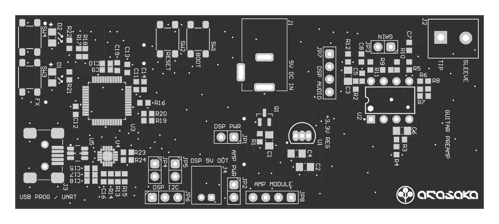
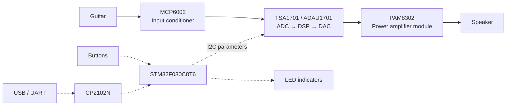

# Portable Guitar MultiFX

A custom guitar-input and control PCB for a compact digital-effects practice amplifier. Designed by **Javier Estiven León Calderón**, Electronic Engineering, **Universidad Nacional de Colombia**.

**Hardware design complete · Fabrication and assembly pending**

The repository contains the Altium project, five-sheet schematic, two-layer PCB, fabrication files, assembly drawing, bill of materials, and STEP model. The design combines a high-impedance guitar input with an STM32 controller and external audio modules. Firmware, SigmaStudio sources, and measured prototype results are not included in this handoff.



*Top-side fabrication snapshot; illustrative colors. This rendering is not a photograph or an ERC/DRC result.*

## The design



The custom PCB provides **5 V power distribution**, a **3.3 V control supply**, MCP6002 input conditioning, buttons, indicators, and module interfaces. The STM32 manages controls; audio conversion and processing remain in the TSA1701. The PAM8302 drives a separate speaker.

Clean/drive operation and equalization are the intended software scope. These are design goals until the deployed DSP program and test results are documented.

## Explore the hardware

| Deliverable | File |
|---|---|
| Schematics — view without Altium | [Schematic PDF](hardware/outputs/schematics/Schematics.pdf) |
| Editable design | [Altium project](hardware/altium/Portable_Guitar_MultiFX/Portable_Guitar_MultiFX.PrjPcb) |
| PCB layout | [PCB document](hardware/altium/Portable_Guitar_MultiFX/Portable_Guitar_MultiFX.PcbDoc) |
| Fabrication snapshot | [Gerber and drill ZIP](hardware/outputs/fabrication/Gerbers.zip) |
| Bill of materials | [BOM spreadsheet](hardware/outputs/bom/Portable_Guitar_MultiFX.xlsx) |
| Assembly drawing | [Draftsman document](hardware/altium/Draftsman/Portable_Guitar_MultiFX.PCBDwf) |
| Mechanical model | [STEP model](hardware/outputs/3d/MultiFX.step) |

Read the [hardware guide](hardware/README.md) for the sheet map, opening instructions, dependencies, and checks to complete before manufacturing. The supplied fabrication package is a dated export; its consistency with the final editable PCB and a clean DRC result have not been established in this repository.

The [application note — PDF](docs/application-note/application-note.pdf) explains the design calculations, interfaces, staged bring-up, and validation protocol. Its [LaTeX source and analysis](docs/application-note/README.md) are reproducible; this revision precedes fabrication and contains no measured prototype results.

## Repository map

```text
hardware/
  altium/       Authoritative project and linked Draftsman document
  outputs/      Schematic PDF, BOM, fabrication ZIP, and STEP model
  archive/      Original delivery snapshots and submission archive
docs/           Application note, earlier studies, and presentation assets
web/            Static project website
```

All supplied design files and archives are preserved. Earlier PCB copies are retained in `hardware/archive/`; use `hardware/altium/` for continued editing. Altium history, previews, logs, and local working notes remain on disk and are excluded from Git.

## Project record

The [documentation index](docs/README.md) links the initial architecture report and feasibility study. Those documents record earlier decisions, including superseded component choices; the current hardware guide describes the delivered design.

The remaining work is fabrication, assembly, firmware/DSP integration, and recorded electrical and audio validation. Current local phase notes: `context/02-application-note.md`.

## Website

The [project website](web/index.html) uses plain HTML, CSS, and JavaScript. The [GitHub Pages workflow](.github/workflows/pages.yml) publishes only `web/` when that directory changes on `main`, or when run manually. Select **GitHub Actions** as the Pages source in the repository settings. The amplifier illustration is a concept, not a photograph of an assembled prototype.
