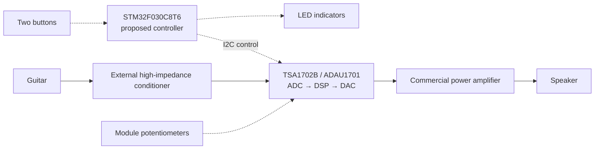

# Portable Guitar MultiFX

A compact guitar practice amplifier with digital effects and simple physical controls. The goal is to integrate instrument input conditioning, DSP, amplification, and a speaker into one practical prototype.

Developed as an Electronic Design project at Universidad Nacional de Colombia. This repository will document the progression from engineering assumptions to measured prototype behavior.

**Current phase:** [00 — Project baseline](context/00-project-baseline.md).

## Proposed architecture

Solid arrows show audio; dashed arrows show control. The STM32 manages the interface and DSP parameters; audio conversion and processing remain inside the DSP module. The main PCB is intended to integrate control, power distribution, and module connections.

The initial target is mono audio, clean and drive modes with equalization, two buttons, LED feedback, and parameter adjustment through the module potentiometers. Normal operation should use an external power supply and require no computer after programming. Battery operation, a display, and additional effects are outside the initial target.

## Current status

The architecture is a proposal. A TSA1702B module and USBi programmer are reported available, but their exact revisions and operation have not been verified in the recorded evidence. No complete audio-chain test, deployed control firmware, fabricated MultiFX PCB, or validated system power budget is recorded.

The fixed component rule is to use the professor's Altium library for the main PCB. Other physically obtainable components must connect externally through headers; DSP-module use is accepted. The architecture can evolve within these constraints.

**Next milestone:** verify the actual hardware and library, then demonstrate clean audio, autonomous DSP startup, and a parameter change from an external controller before committing to the main PCB design. Define measurable acceptance conditions before each bench test.

## Repository growth

Create each technical directory when its first real artifact exists:

| Directory | Purpose |
|---|---|
| `hardware/` | Circuit design, calculations, PCB, and BOM. |
| `firmware/` | Controller code and relevant checks. |
| `dsp/` | SigmaStudio project and required integration exports. |
| `docs/` | Validation results, diagrams, photographs, and demonstrations. |

`context/` preserves continuity between phases. Maintain one `NN-phase-name.md` file per phase, update it while active, and close it with outcomes and remaining questions. Keep this README linked to the current phase and the strongest project evidence as it becomes available.

Keep durable technical explanations beside their artifacts. Label calculations, simulations, software checks, and physical measurements accurately; proposed performance is not a measured result.

Contributor and agent working rules are in [AGENTS.md](AGENTS.md). Original reference material remains local and is excluded from version control.
