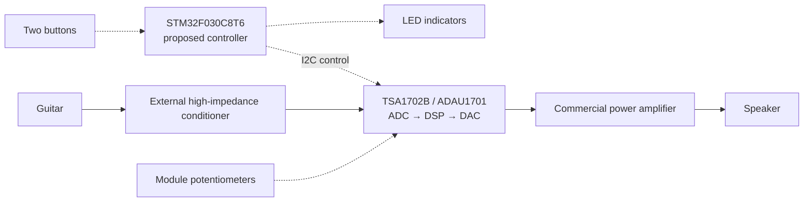

# Portable Guitar MultiFX

A compact guitar practice amplifier with digital effects and simple physical controls. The goal is to integrate instrument input conditioning, DSP, amplification, and a speaker into one practical prototype.

Developed as an Electronic Design project at Universidad Nacional de Colombia. This repository will document the progression from engineering assumptions to measured prototype behavior.

**Current phase:** 00 — Project baseline. Working notes are kept locally in `context/00-project-baseline.md`.

## Proposed architecture



Solid arrows show audio; dashed arrows show control. The STM32 manages the interface and DSP parameters; audio conversion and processing remain inside the DSP module. The main PCB is intended to integrate control, power distribution, and module connections.

The initial target is mono audio, clean and drive modes with equalization, two buttons, LED feedback, and parameter adjustment through the module potentiometers. Normal operation should use an external power supply and require no computer after programming. Battery operation, a display, and additional effects are outside the initial target.

## Current status

The architecture is a proposal. A TSA1702B module and USBi programmer are reported available, but their exact revisions and operation have not been verified in the recorded evidence. No complete audio-chain test, deployed control firmware, fabricated MultiFX PCB, or validated system power budget is recorded.

The fixed component rule is to use the professor's Altium library for the main PCB. Other physically obtainable components must connect externally through headers; DSP-module use is accepted. The architecture can evolve within these constraints.

**Next milestone:** verify the actual hardware and library, then demonstrate clean audio, autonomous DSP startup, and a parameter change from an external controller before committing to the main PCB design. Define measurable acceptance conditions before each bench test.

## Architecture report

The [IEEE LaTeX report](docs/system-architecture.tex) presents the context diagram, hardware block diagram, and software organigram. It describes the proposed architecture; hardware verification remains pending.

To compile, upload the single `.tex` file to the root of a blank Overleaf project, [set it as the main document](https://docs.overleaf.com/getting-started/recompiling-your-project/the-main-document), select **pdfLaTeX**, and recompile until references resolve. Check that the PDF has 3–4 pages and legible figures without overlap or clipping. No native LaTeX compiler was found in the inspected environment; compilation, page count, and PDF visual validation remain pending in Overleaf.

## Project website

The [website source](web/index.html) is a buildless HTML/CSS/JavaScript presentation of the project, with a white-and-black visual direction inspired by [Duo Case](https://www.duocase.lol/) and [RUSHES.](https://www.framer.com/marketplace/templates/rushes/). Space Grotesk and Inter load from Google Fonts, with system-font fallbacks. The original enclosure illustration is conceptual; the website distinguishes planned behavior from verified hardware results.

Preview locally from the repository root:

```powershell
python -m http.server 8000 --directory web
```

Open `http://localhost:8000`. To publish, select **Settings → Pages → Build and deployment → Source: GitHub Actions** in the GitHub repository, then commit and push the website and workflow to `main`. The workflow deploys only `web/` and reports the published URL after a successful run; deployment has not yet been verified.

## Repository growth

The technical directories are organized as follows:

| Directory | Purpose |
|---|---|
| `hardware/` | Circuit design, calculations, PCB, and BOM. |
| `firmware/` | Controller code and relevant checks. |
| `dsp/` | SigmaStudio project and required integration exports. |
| `docs/` | Validation results, diagrams, photographs, and demonstrations. |
| `web/` | Static project website and its visual assets. |

Empty technical directories are kept locally and enter version control when they contain project artifacts. Local `context/` notes preserve continuity between phases; this README presents the current status and links to project evidence as it becomes available.

Keep durable technical explanations beside their artifacts. Label calculations, simulations, software checks, and physical measurements accurately; proposed performance is not a measured result.

Agent configuration, working instructions, phase context, and original reference material remain local and are excluded from version control.
